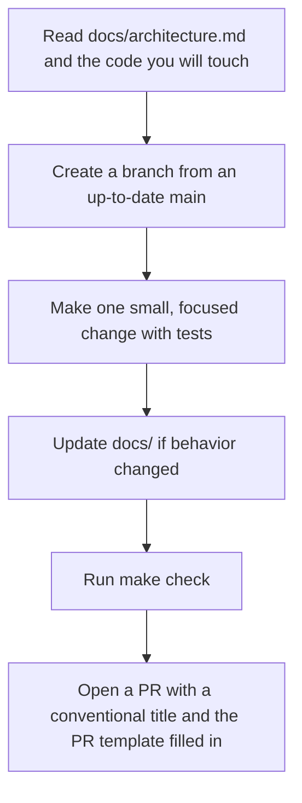

# AI Agent Guidelines

These rules apply to every AI coding agent working in this repository (Claude Code, Codex, Copilot, Cursor, and others). The root `AGENTS.md` and `CLAUDE.md` files point here.

## Hard rules

1. **Never commit to `main` and never push to it.** Create a branch named `<type>/<short-description>` and open a pull request.
2. **The pull request title must follow the conventional format** described in [contributing.md](contributing.md), for example `feat(esclient): detect cluster version`. Validate it with `scripts/check-pr-title.sh "<title>"` before opening the pull request.
3. **English only.** Code, comments, identifiers, logs, errors, docs, commit messages and PR text must contain no Chinese or other CJK text. Reply to the user in the language they use, but never write non-English text into the repository.
4. **Diagrams are Mermaid.** Architecture, sequence and flow diagrams are Mermaid code blocks inside `docs/`. Do not add image files for diagrams.
5. **Documentation lives in `docs/`.** Update the relevant document in the same pull request as the behavior change. Do not add new documentation files at the repository root.
6. **Run `make check` before opening a pull request** and fix every failure. Do not weaken or skip checks to make them pass.
7. **Never commit secrets**: tokens, passwords, private keys, real hostnames or cluster URLs.

## Working method

- Keep pull requests small and single-purpose. Split large features into stacked pull requests.
- Prefer clear names and small functions. Add a comment only when it explains why, not what.
- Follow the conventions in [development.md](development.md). Do not introduce new dependencies without a clear need, and justify each one in the PR description.
- Do not edit lock files by hand. Regenerate them with the package manager.
- Match the existing structure: Go packages under `internal/`, front-end features under `web/src/features/`.
- When unsure about a product decision, ask the user instead of guessing.

## Pull request description

Fill in the PR template: a short summary, a list of changes, and the completed checklist. State anything you could not verify.
