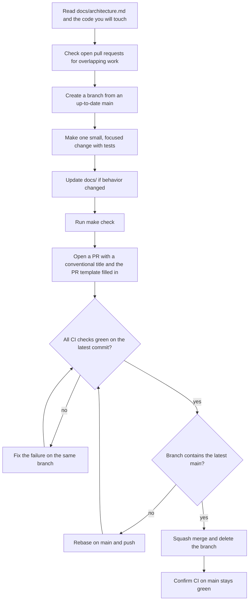

# AI Agent Guidelines

These rules apply to every AI coding agent working in this repository (Claude Code, Codex, Copilot, Cursor, and others). The root `AGENTS.md` and `CLAUDE.md` files point here.

Searchboard is developed by several agents working in parallel, together with human maintainers. The rules below keep that safe: all work is isolated on branches, all changes arrive through pull requests, and CI is the gate that decides when a change may be merged.

## Hard rules

1. **Never commit to `main` and never push to it.** Create a branch named `<type>/<short-description>` and open a pull request.
2. **The pull request title must follow the conventional format** described in [contributing.md](contributing.md), for example `feat(esclient): detect cluster version`. Validate it with `scripts/check-pr-title.sh "<title>"` before opening the pull request.
3. **English only.** Code, comments, identifiers, logs, errors, docs, commit messages and PR text must contain no Chinese or other CJK text. Reply to the user in the language they use, but never write non-English text into the repository.
4. **Diagrams are Mermaid.** Architecture, sequence and flow diagrams are Mermaid code blocks inside `docs/`. Do not add image files for diagrams.
5. **Documentation lives in `docs/`.** Update the relevant document in the same pull request as the behavior change. Do not add new documentation files at the repository root.
6. **Run `make check` before opening a pull request** and fix every failure. Do not weaken or skip checks to make them pass.
7. **Never commit secrets**: tokens, passwords, private keys, real hostnames or cluster URLs.
8. **Merge only through squash and merge, only after CI is green, and only your own pull requests.** See [Merging your pull request](#merging-your-pull-request).

## Working method



- Keep pull requests small and single-purpose. Split large features into stacked pull requests.
- Prefer clear names and small functions. Add a comment only when it explains why, not what.
- Follow the conventions in [development.md](development.md). Do not introduce new dependencies without a clear need, and justify each one in the PR description.
- Do not edit lock files by hand. Regenerate them with the package manager.
- Match the existing structure: Go packages under `internal/`, front-end features under `web/src/features/`.
- When unsure about a product decision, ask the user instead of guessing.

## Working alongside other agents

Other agents are changing the repository at the same time. Assume that `main` moves while you work.

- **One task, one branch, one pull request.** Give the branch a unique, descriptive name. Never push to a branch that another agent or a human created.
- **Start from fresh code.** Run `git fetch origin` and branch from `origin/main`.
- **Look before you start.** Run `gh pr list --state open` and check whether an open pull request touches the same files or feature. Build on it or wait for it to merge instead of duplicating the work.
- **Stay in scope.** Change only what the task needs. Do not mix in drive-by refactors or reformatting, because they cause conflicts for everyone else.
- **Use an isolated working copy.** Do not share a working directory between agents. Use a separate clone or `git worktree`.
- **Resolve conflicts by rebasing onto `main`** and keeping the other side's intent. Never resolve a conflict by discarding another agent's work. Regenerate lock files and generated files instead of merging them by hand.
- **Only force-push your own branch**, and use `git push --force-with-lease`. Never force-push `main` or someone else's branch.
- **Leave context for the next agent.** The PR description states what changed, why, and anything you could not verify.

## Merging your pull request

An agent merges its own pull request without waiting for a human approval, as long as every condition below holds:

1. Every CI check is green on the latest commit of the branch: `PR title`, `Language policy`, `Script tests`, `Go`, `Rust agent` and `Web`. Pending, skipped or cancelled checks do not count. A new push restarts the checks.
2. The branch contains the latest `main`. If `main` moved, rebase onto it, push, and wait for CI to pass again.
3. The PR description follows the template and the checklist is complete.
4. No change request or open question from a human maintainer or another agent is waiting for an answer.

Then merge with **squash and merge** and delete the branch:

```bash
gh pr checks <number> --watch
gh pr merge <number> --squash --delete-branch --subject "<PR title> (#<number>)"
```

The squash commit subject must equal the PR title, because the title is what remains in the history of `main`. If GitHub auto-merge is enabled for the repository, `gh pr merge <number> --squash --delete-branch --auto` merges as soon as the required checks pass.

After merging:

- Update your local `main` with `git switch main && git pull --ff-only`.
- Watch the CI run that the merge triggers on `main`. If it fails because of your change, open a fix pull request right away, or a `revert` pull request if the fix is not quick.

Never do any of the following:

- Merge with a failing, pending or skipped check, or bypass branch protection (for example `gh pr merge --admin`).
- Edit, disable or weaken a workflow, a check script or a branch protection rule to get a pull request green.
- Use merge commits or rebase merges. Squash is the only merge method.
- Merge a pull request that someone else opened. Leave it to its author.
- Work around a merge block. If branch protection or a required review prevents the merge, stop and ask a human maintainer to review.

## Pull request description

Fill in the PR template: a short summary, a list of changes, and the completed checklist. State anything you could not verify.
