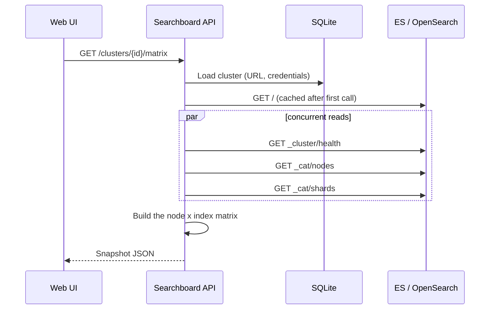

# HTTP API

All endpoints live under `/api/v1`, accept and return JSON, and report errors as:

```json
{ "error": "human readable message" }
```

Cluster credentials are write-only: no endpoint ever returns a password.

Every response carries an `X-Request-Id` header. A client may send its own (up to 128 characters of letters, digits, `-`, `_` and `.`); otherwise one is generated. The same ID appears in the access log, which makes a failing request easy to find.

The server is built on the in-house [framework](framework.md). Paths under `/api/` that match no route answer a JSON `404`; wrong methods answer a JSON `405` with an `Allow` header. Every other path serves the embedded web UI: files as they are (content-hashed assets are cached for a year), and extension-less client-side routes get `index.html`.

## Data flow



## Endpoints

| Method | Path | Description |
| :--- | :--- | :--- |
| `GET` | `/healthz` | Liveness probe |
| `GET` | `/clusters` | List registered clusters |
| `POST` | `/clusters` | Register a cluster after verifying it is reachable |
| `DELETE` | `/clusters/{id}` | Remove a cluster from Searchboard (the cluster itself is untouched) |
| `GET` | `/clusters/{id}/matrix` | Cluster health, nodes and the shard matrix |
| `GET` | `/clusters/{id}/allocation-explain` | Why a shard copy is unassigned |

### `POST /clusters`

Request body (unknown fields are rejected):

| Field | Type | Notes |
| :--- | :--- | :--- |
| `name` | string | Required, unique, at most 64 characters |
| `url` | string | Required, absolute `http` or `https` URL |
| `username`, `password` | string | Optional basic-auth credentials |
| `env` | string | `prod`, `staging` or `dev` (default `dev`). `prod` triggers guard rails in the UI |
| `insecure_skip_verify` | bool | Skip TLS verification for this cluster |

Searchboard contacts the cluster before storing anything.

| Status | Meaning |
| :--- | :--- |
| `201` | Created. Body is the cluster without its password |
| `400` | Invalid input |
| `409` | A cluster with this name already exists |
| `422` | The cluster could not be reached or rejected the credentials |

### `GET /clusters/{id}/matrix`

```json
{
  "cluster": { "id": "939d665713c2ee74", "name": "demo", "env": "prod" },
  "version": "elasticsearch 7.17.0",
  "health": { "cluster_name": "demo", "status": "yellow", "unassigned_shards": 1 },
  "nodes": [
    { "id": "a1B2", "name": "node-1", "ip": "10.0.0.1", "roles": "dimr", "is_master": true, "heap_pct": 41, "cpu_pct": 7, "disk_pct": 63.2 }
  ],
  "indices": [
    {
      "name": "logs",
      "health": "yellow",
      "cells": {
        "a1B2": [{ "shard": 0, "primary": true, "state": "STARTED", "docs": 120, "store_bytes": 2048 }]
      },
      "unassigned": [{ "shard": 1, "primary": false, "state": "UNASSIGNED", "unassigned_reason": "NODE_LEFT" }]
    }
  ],
  "generated_at": "2026-11-20T08:49:06Z"
}
```

- `cells` maps a node ID to the shard copies it holds. A relocating shard stays on its source node and carries `relocating_to`.
- Resource percentages on a node are omitted when the node did not report them.
- Index `health` follows the Elasticsearch rule: `red` when a primary is not active, `yellow` when only replicas are missing, otherwise `green`.
- The whole snapshot fails with `502` if any cluster call fails, so a partial matrix is never shown.

### `GET /clusters/{id}/allocation-explain`

Query parameters: `index` (required), `shard` (non-negative integer, required), `primary` (`true` or `false`, required).

| Status | Meaning |
| :--- | :--- |
| `200` | Summary with only the deciders that blocked or throttled allocation |
| `400` | Missing or malformed parameter |
| `422` | The cluster has nothing to explain, usually because the shard is assigned |

## Error mapping

| Status | When |
| :--- | :--- |
| `404` | Unknown cluster ID, or an unknown path under `/api/` |
| `405` | Method not allowed for the path, with an `Allow` header |
| `413` | Request body larger than 1 MiB |
| `500` | Unexpected server error. Details are logged with the request ID, never returned |
| `502` | The cluster is unreachable or answered with an error. Upstream response bodies are logged but never returned |
