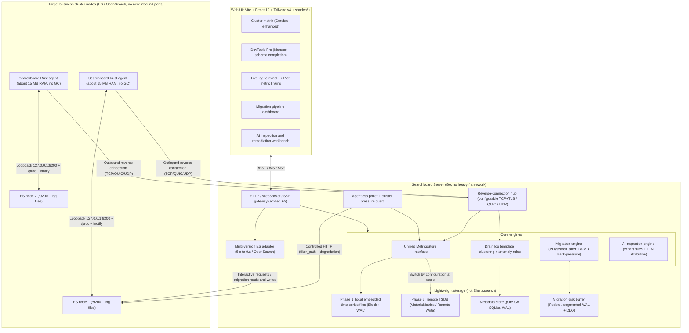
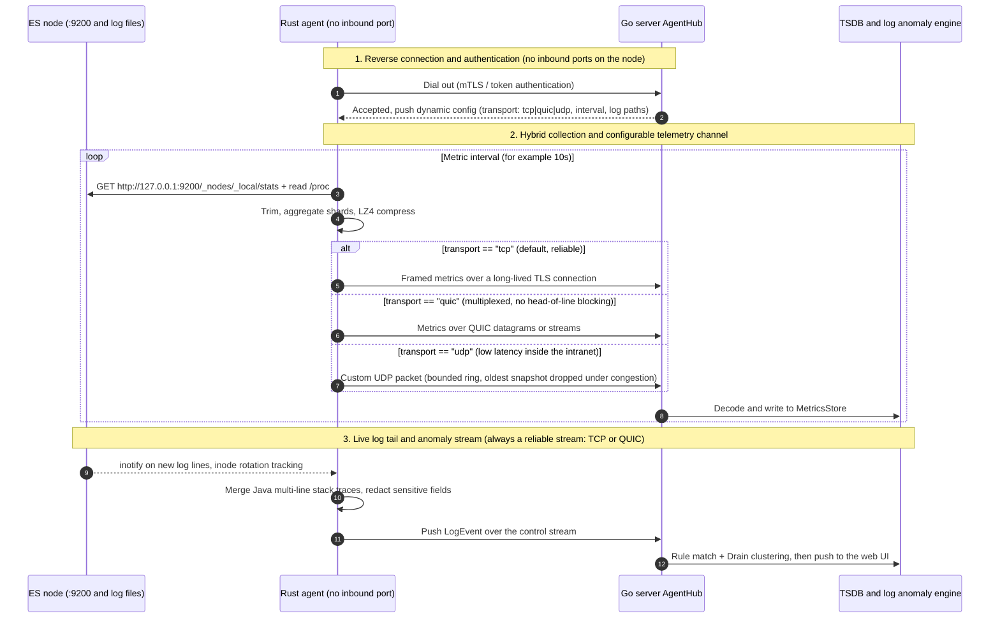

# Searchboard Architecture

> **Version**: v1.0
> **Positioning**: a lightweight, highly reliable observability, data migration and intelligent operations platform for Elasticsearch and OpenSearch.
> **Core stack**: Go (server), Rust (agent), Vite + React 19 + Tailwind CSS v4 + shadcn/ui (web).

## 1. Design philosophy and the problems it solves

| Pain point in existing tools (INFINI Console/Gateway, Cerebro, ...) | Searchboard approach |
| :--- | :--- |
| **Heavy shared frameworks** (such as `framework`) make the code tightly coupled and hard to customize. | **Native, modular Go**: no heavy framework. Only the standard library and orthogonal components (`chi`, `modernc.org/sqlite`, `prometheus/tsdb`). The core domain is written against interfaces. |
| **Monitoring data is written back into Elasticsearch**, which is heavy and can take the cluster down during a monitoring storm. | **Progressive storage**: metrics are immutable, append-only time series. A single node uses a **local time-series file engine** with zero external dependencies. At scale the same interface switches to VictoriaMetrics. |
| **Agentless polling can overload business clusters**, while opening extra monitoring ports on nodes is a security risk. | **Dual-mode collection plus a reverse Rust agent**: the agent on each node dials out to the server (no inbound ports) and aggregates shard and node metrics locally. Agentless mode has a built-in pressure circuit breaker. |
| **Migration relies on `scroll` and blind `_bulk`**, which piles up contexts or causes OOM on the source and `429` rejections on the target. | **Next-generation migration engine**: `PIT + search_after + slice` first (controlled `scroll` only for old clusters), a local Pebble/WAL disk buffer to decouple read and write, and **AIMD adaptive back-pressure** on the target. |
| **Fragmented UI**: cluster state lives in Cerebro, DSL in Kibana DevTools. | **One modern workbench**: Cerebro's intuitive shard matrix plus Kibana DevTools' smart completion, linking metric curves, live node logs and AI inspection. |

## 2. System overview



## 3. Repository layout

The Go server compiles to a single binary. The web assets are embedded with `embed.FS`.

```text
searchboard/
├── cmd/searchboard/        # entry point, dependency wiring, graceful shutdown
├── internal/
│   ├── config/             # YAML / environment configuration
│   ├── domain/             # pure domain models
│   ├── esclient/           # multi-version Elasticsearch / OpenSearch adapter
│   ├── matrix/             # builds the cluster shard matrix from nodes and shards
│   ├── tsdb/               # MetricsStore interface, local engine, remote-write adapter
│   ├── collector/          # agentless polling and the pressure guard
│   ├── agenthub/           # reverse-connection gateway for the Rust agent
│   ├── logengine/          # live log fan-out, Drain clustering, anomaly rules
│   ├── migration/          # reader, disk queue, AIMD writer, dead-letter queue
│   ├── inspector/          # deterministic checks and LLM diagnosis orchestration
│   ├── store/              # SQLite repositories and schema migrations
│   └── api/                # HTTP router, handlers, embedded web UI
├── agent-rs/               # lightweight Rust node agent
├── web/                    # Vite + React 19 + Tailwind v4 + shadcn/ui front end
└── docs/                   # all project documentation
```

## 4. Metric storage and dual-mode collection

### 4.1 Metric storage: start with local files, evolve to a TSDB

A single storage interface keeps the business layer unaware of the engine:

```go
type MetricsStore interface {
    WriteBatch(ctx context.Context, points []domain.MetricPoint) error
    QueryRange(ctx context.Context, q domain.RangeQuery) ([]domain.TimeSeries, error)
    RetentionGC(ctx context.Context) error
    Close() error
}
```

- **Phase 1 (single node, zero dependencies, default)**
  - A pure Go embedded time-series store: either the core `prometheus/prometheus/tsdb` package, or a custom WAL plus Gorilla XOR compressed blocks under `data/metrics/{cluster_id}/{YYYY-MM-DD}/`.
  - Writes are immutable. Expired data is removed by deleting whole day directories after the retention period (for example 14 days), so there is no fragmentation and no GC pressure.
- **Phase 2 (large clusters)**
  - With `tsdb.mode: remote` the store switches to **Prometheus Remote Write plus a PromQL HTTP client** talking to **VictoriaMetrics**. Dashboards and AI inspection code stay unchanged.

### 4.2 Dual-mode collection and the cluster pressure guard

1. **Mode A: agent-side aggregation (recommended)**
   - The Rust agent reads `127.0.0.1:9200/_nodes/_local/stats` for node and shard statistics and combines them with `/proc` metrics (disk IO, page cache, TCP retransmits). It compresses and reports the result, so no coordinating node has to assemble a huge cluster-wide JSON document.
2. **Mode B: agentless collection by the server (managed ES where no agent can be installed)**
   - **Field trimming**: always send `filter_path` and fetch only core metrics, cutting serialization and network cost by about 80%.
   - **Tiered frequency**: `_cluster/health` (15s) > node and index core metrics (30 to 60s) > heavy endpoints such as `_cat/segments` and `_nodes/hot_threads` (never polled on a schedule, on demand only).
   - **Pressure circuit breaker**: watches response latency and status codes. On `HTTP 429`, a request slower than `3s`, or a target node with `Heap > 85%` or `CPU > 90%`, the collector backs off exponentially (intervals grow to 60s, then 300s) and pauses non-essential detail collection to protect production traffic.

## 5. Rust agent and the configurable reverse-connection protocol

The agent is written in Rust (`tokio`, `rustls`, `quinn`): a single 6 to 8 MB binary, under 20 MB of resident memory, **no GC pauses**, and no competition with the ES JVM.

### 5.1 Reverse connection and protocol flow



### 5.2 Transport configuration

- **Control and log stream (fixed `TCP+TLS` or `QUIC stream`)**: heartbeats, hot config updates, remote probe commands, and the **live log stream, which must not be lost or reordered**.
- **High-frequency telemetry channel (configurable `tcp | quic | udp`)**:
  - **`tcp`**: the most firewall and NAT friendly, with built-in flow control. Recommended default.
  - **`udp`**: packet layout `[Magic 2B][Ver 1B][Type 1B][AgentID 8B][Seq 4B][Flags 1B][CRC32 4B][Protobuf]`. The agent uses a **bounded lock-free ring (drop oldest)**, so packet loss or congestion never back-pressures the ES node.
  - **`quic`**: multiplexing and connection migration over UDP, with no head-of-line blocking and full reliability.

## 6. Live node logs and automatic anomaly detection

1. **Lightweight pre-processing in the agent**
   - Use `notify` and inode tracking to survive `logrotate`. Checkpoints are stored in local `.offset` files.
   - **Java multi-line merge**: lines that do not start with a timestamp (such as `at ...` and `Caused by:`) are merged into one event before reporting.
2. **Two-level anomaly detection in the server**
   - **L1: deterministic rules plus online Drain clustering (millisecond latency, zero LLM cost)**
     - Built-in ES signature dictionary: `OutOfMemoryError`, `CircuitBreakingException`, `EsRejectedExecutionException`, stop-the-world GC warnings, `flood stage` read-only disks, `master_not_discovered`.
     - A pure Go **Drain** implementation strips IPs, numbers and index names to produce log templates, and surfaces never-seen exception templates and sudden spikes of old templates.
   - **L2: AI root-cause analysis**: when an anomaly fires, the metrics of the same node one minute before and after, plus the stack template, are submitted on demand to the AI engine to produce a diagnosis report.

## 7. Next-generation Elasticsearch migration engine

It removes the two classic failure modes: `scroll` pinning source memory and segments, and uncontrolled `_bulk` overloading the target.

### 7.1 Migration pipeline and AIMD back-pressure

```mermaid
flowchart LR
    Src["Source ES cluster"] -->|"Priority 1: PIT + search_after + slice<br/>Priority 2: search_after<br/>Fallback (5.x only): controlled scroll"| Reader["Migration reader<br/>(concurrent slices)"]

    Reader -->|"Serialized documents and cursors"| DiskQueue[("Local disk buffer<br/>Pebble / segmented WAL<br/>+ checkpoint + DLQ")]

    DiskQueue -->|"Asynchronous consumption<br/>(read and write speeds fully decoupled)"| Writer["AIMD back-pressure writer<br/>tunes concurrency / batch_docs / batch_bytes"]

    Writer -->|"Adaptive _bulk requests<br/>(retry only the failed subset)"| Dst["Target ES cluster"]

    Dst -.->|"Feedback:<br/>429 / rejected / write queue<br/>Heap > 85% / bulk P99 latency"| AIMD["AIMD congestion controller<br/>healthy: additive increase (+1)<br/>congested: multiplicative decrease (x 0.5 + jittered backoff)"]
    AIMD --> Writer
    Writer -->|"400 mapping-conflict documents"| DLQ["Dead-letter queue (dlq.jsonl)"]
```



### 7.2 Core mechanisms

1. **Tiered reader cursor strategy**
   - **Preferred (ES 7.10+ / 8.x+ / OpenSearch)**: `PIT (point in time) + search_after + slice`. PIT is lightweight and does not pin old segments for long. `search_after` is stateless paging and supports sliced concurrency, which greatly reduces source memory use.
   - **Second choice (ES 6.8 to 7.9)**: `search_after` over time or ID ranges.
   - **Fallback (ES 5.x and others that only support scroll)**: controlled `scroll` with strict limits on concurrent slices and batch `size`. Each slice calls `DELETE /_search/scroll` as soon as it finishes.
2. **Local disk buffer and resumable checkpoints**
   - `cockroachdb/pebble` (or a disk ring WAL in 128 MB segments) isolates the read and write sides. **Once reading finishes, the PIT or scroll is closed immediately and the source is relieved**; the writer drains the local buffer into the target at its own pace.
   - `Checkpoint{slice_id, last_sort_values, disk_offset, bulk_acked_seq}` is persisted atomically, so a restart resumes exactly. Documents rejected with `400` because of field conflicts go to the dead-letter queue (DLQ) without blocking the main flow.
3. **Writer AIMD back-pressure**
   - While healthy (no `429`, target `Heap < 75%`, stable bulk latency), concurrency and batch documents or bytes grow by an additive step.
   - On negative feedback (`429 Too Many Requests`, `EsRejectedExecutionException`, a side probe seeing a `thread_pool.write.queue` backlog, or `Heap > 85%`), concurrency and batch size are **halved (`* 0.5`)** and exponential backoff starts. For a partially failed bulk (`errors: true`) only the failed subset is retried, so traffic is never amplified.
4. **Cross-version conversion and reconciliation**: `_type` is stripped automatically (ES 6/7 to 8+), index settings are rewritten for compatibility, and after the task a `_count` reconciliation and random sample hash check are provided.

## 8. AI inspection

A safe loop of **deterministic expert rules, LLM reasoning and human-confirmed execution** that avoids model hallucination:

1. **Stage 1: deterministic rule engine**
   - Collects the last hour of metric trends, shard distribution, segment counts, mapping field counts and Drain anomaly templates.
   - Runs 30+ deterministic checks (for example: a shard above 50 GB, shards per node above `Heap(GB) * 20`, mapping fields approaching the 1000 limit, GC pause ratio above 5%) and produces a compact structured summary JSON.
2. **Stage 2: LLM attribution and controlled remediation**
   - Submits the summary to a configurable model backend (OpenAI, DeepSeek, an in-house Ollama, ...) and returns a **cross-dimensional causal analysis** and **executable remediation DSL**.
   - Every suggestion that mutates cluster state carries a risk level and is offered as "load into the DevTools sandbox" or "audited execution after manual confirmation". **The AI never silently executes high-risk changes.**

## 9. Web UI architecture and core pages

### 9.1 Technology choices

- **Framework**: `Vite`, `React 19`, `TypeScript`.
- **Styling and UI kit**: `Tailwind CSS v4` (`@tailwindcss/vite`), `shadcn/ui` (New York style), `lucide-react`, `sonner`.
- **Data and state**: `TanStack Query v5` (server polling and caching), `Zustand` (multi-tab workspace, persisted history).
- **Professional components**:
  - `Monaco Editor`: the DevTools editor.
  - `uPlot`: a high-performance canvas time-series chart for very large metric sets.
  - `TanStack Table v8` and `TanStack Virtual`: virtual scrolling for 100k-row index tables and live log streams.

### 9.2 Core views

1. **Cluster Matrix (Cerebro, enhanced)**
   - A shard heat matrix with indices on rows and nodes on columns, clearly distinguishing primary, replica, relocating and unassigned shards.
   - Unassigned shards show a `_cluster/allocation/explain` summary, nodes show live CPU, heap and disk bars, and shard operations require a confirmation step.
2. **DevTools Pro (beyond the Kibana console)**
   - Multi-tab workspace, `Cmd+K` history search, a red **`PROD` frame and confirmation for dangerous requests**.
   - **Live schema completion**: index names and the mapping field tree of the current cluster are synced and cached for exact path and DSL suggestions.
   - **Three result views**: JSON tree, **flattened table (one-click CSV/Excel export)**, and aggregation charts.
3. **Node Telemetry and Live Logs (linked metrics and logs)**
   - A `uPlot` metric curve above a live log terminal. Clicking an `ERROR` line marks the time on the curve, and brushing a spike filters the logs of that period.
4. **Migration Pipeline Studio**
   - Visualizes `source read rate -> local disk queue backlog -> AIMD concurrency and back-pressure state -> target write rate`, plus a dead-letter queue (DLQ) replay panel.

## 10. Phased roadmap

| Phase | Milestone | Deliverables |
| :--- | :--- | :--- |
| **Phase 1 (MVP)** | Replace Cerebro and DevTools | Go server skeleton, SQLite, multi-version ES adapter, front-end matrix and DevTools Pro (single binary release). |
| **Phase 2 (observability)** | Lightweight monitoring and live log anomalies | Embedded local TSDB, agentless collection with circuit breaker, Rust agent (TCP+TLS reverse connection), Drain log clustering, linked uPlot panels. |
| **Phase 3 (reliable migration)** | Surpass traditional migration tools | Pebble/WAL disk buffer, PIT and `search_after` reader, AIMD back-pressure writer, optional QUIC/UDP agent modes. |
| **Phase 4 (intelligence and scale)** | Scale and AI operations | Deterministic inspection rules, LLM integration, VictoriaMetrics Remote Write adapter, RBAC and webhook alerts. |
