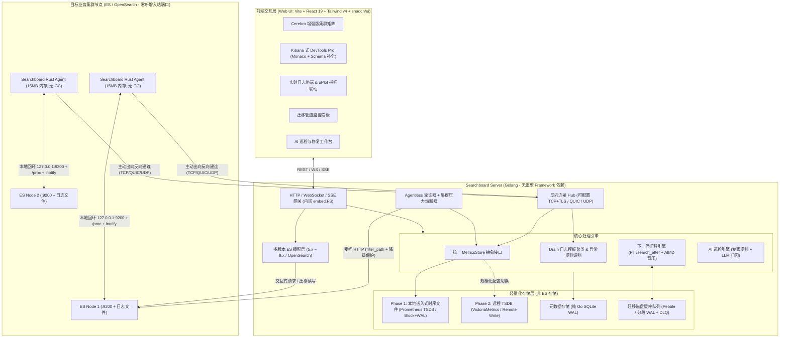
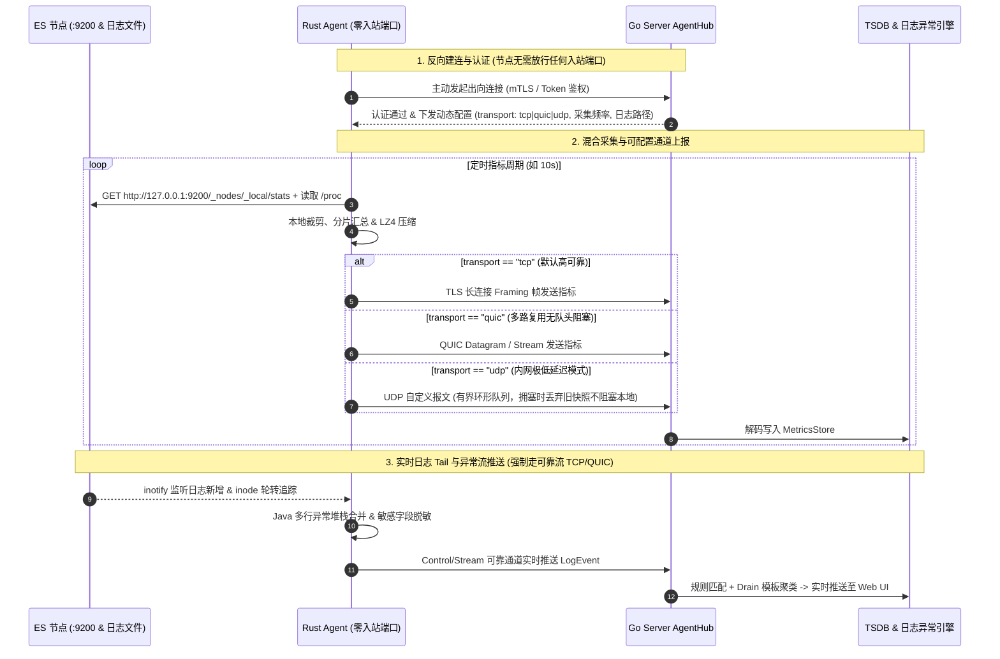
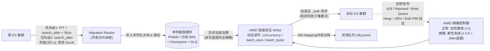

# Searchboard 架构设计文档

> **版本**：v1.0  
> **定位**：新一代轻量级、高可靠 Elasticsearch / OpenSearch 可观测性、数据迁移与智能运维平台  
> **核心技术栈**：Golang (Server) + Rust (Agent) + Vite / React 19 / Tailwind CSS v4 / shadcn/ui (Web)

---

## 1. 设计哲学与核心痛点突破

| 传统工具痛点 (INFINI Console/Gateway, Cerebro 等) | Searchboard 架构解法 |
| :--- | :--- |
| **强绑定重型公共框架**（如 `framework`），代码耦合度高、难以定制 | **Go 原生模块化架构**：零重型框架侵入，仅依赖标准库及正交组件（`chi`, `modernc.org/sqlite`, `prometheus/tsdb`），核心域完全面向接口编程。 |
| **监控数据反向写入 ES**，不仅笨重，还可能因监控风暴拖垮 ES 集群 | **存储渐进式演进**：监控指标属于不可变 Append-Only 时序数据，单机默认使用**本地时序文件引擎**（零外部依赖）；规模化后通过统一接口无缝切换至 VictoriaMetrics。 |
| **Agentless 轮询易打爆业务集群**，或在节点开额外监控端口带来安全隐患 | **双模采集 + Rust 反向 Agent**：优先由节点上的 Rust Agent 主动出向连接 Server（节点免开任何入站端口），本地聚合分片/节点指标；Agentless 模式内置压力熔断器。 |
| **迁移依赖 `scroll` + 盲目 `_bulk`**，极易导致源集群上下文堆积/OOM、目标集群 `429` 拒绝 | **下一代迁移引擎**：优先 `PIT + search_after + Slice`（仅老集群兜底受控 `scroll`）+ 本地 Pebble/WAL 磁盘缓存解耦 + 目标端 **AIMD 动态背压控制**。 |
| **前端界面割裂**，查看集群状态去 Cerebro，写 DSL 去 Kibana DevTools | **现代一体化工作台**：融合 Cerebro 的分片矩阵直观性与 Kibana DevTools 的智能补全能力，并打通"指标曲线 <-> 节点实时日志 <-> AI 巡检"。 |

---

## 2. 系统总体架构



---

## 3. Golang 后端工程结构

保持高内聚、低耦合的标准 Go 布局，编译产出单二进制文件（前端静态资源通过 `embed.FS` 打入）：

```text
searchboard/
├── cmd/
│   └── searchboard/
│       └── main.go              # 启动入口、依赖注入、优雅停机
├── internal/
│   ├── config/                  # YAML / 环境变量配置解析
│   ├── domain/                  # 纯领域模型 (Cluster, MetricPoint, LogEvent, MigrationTask)
│   ├── esclient/                # 多版本 ES 适配层 (屏蔽 5/6/7/8/9 与 OpenSearch API 差异)
│   ├── tsdb/                    # MetricsStore 接口 + 本地文件引擎 + RemoteWrite 适配器
│   ├── collector/               # 采集调度器与集群压力熔断器 (Pressure Guard)
│   ├── agenthub/                # Rust Agent 反向连接接入网关 (TCP/TLS, QUIC, UDP 解码)
│   ├── logengine/               # 实时日志流广播、Drain 在线模板聚类、异常规则引擎
│   ├── migration/               # 迁移引擎 (Reader, DiskQueue/Pebble, AIMD Writer, DLQ)
│   ├── inspector/               # AI 巡检 (确定性规则体检 + LLM 诊断编排)
│   ├── store/                   # 纯 Go SQLite 仓储 (配置、历史、巡检报告)
│   └── api/                     # HTTP Router (chi) + WebSocket/SSE + embed.FS
├── agent-rs/                    # Rust 轻量级 Node Agent 独立工程
└── web/                         # Vite + React 19 + Tailwind v4 + shadcn/ui 前端工程
```

---

## 4. 监控存储与双模采集设计

### 4.1 指标存储：本地文件起步，平滑演进 TSDB

统一抽象存储接口，业务层完全不感知底层实现：

```go
type MetricsStore interface {
    WriteBatch(ctx context.Context, points []domain.MetricPoint) error
    QueryRange(ctx context.Context, q domain.RangeQuery) ([]domain.TimeSeries, error)
    RetentionGC(ctx context.Context) error
    Close() error
}
```

- **Phase 1（单机零依赖模式，默认）**：
  - 采用纯 Go 嵌入式本地时序存储（直接嵌入 `prometheus/prometheus/tsdb` 核心存储包，或按 `data/metrics/{cluster_id}/{YYYY-MM-DD}/` 自研 WAL + Gorilla XOR 压缩 Block 文件）。
  - 数据不可变写入，按保留天数（如 14 天）直接 `os.RemoveAll()` 淘汰过期目录，无碎片、无 GC 压力。
- **Phase 2（大规模集群模式）**：
  - 配置 `tsdb.mode: remote` 后，切换为 **Prometheus Remote Write + PromQL HTTP Client** 对接外部 **VictoriaMetrics**，上层监控面板与 AI 巡检代码零修改。

### 4.2 双模采集与集群压力保护（Cluster Pressure Guard）

1. **模式 A：Agent 本地汇聚（推荐）**
   - Rust Agent 在各节点通过本地 `127.0.0.1:9200/_nodes/_local/stats` 获取节点状态及所属分片统计，结合 `/proc` 系统指标（磁盘 IO、PageCache、TCP 重传）本地压缩汇总后上报，避免由 Coordinator 节点聚合全集群百兆级大 JSON。
2. **模式 B：Server 端 Agentless 采集（适配无法装 Agent 的云托管 ES）**
   - **字段裁剪**：强制携带 `filter_path` 参数，仅拉取核心指标，降低 80% 序列化与网络开销。
   - **分级频次**：`_cluster/health` (15s) > 节点/索引核心指标 (30~60s) > 重型接口如 `_cat/segments`、`_nodes/hot_threads`（默认不定时拉取，仅按需触发）。
   - **压力熔断器**：实时监控目标集群响应延迟与状态码。若出现 `HTTP 429`、请求耗时 `> 3s`、或目标节点 `Heap > 85% / CPU > 90%`，采集器自动触发指数退避（间隔放大至 60s/300s）并暂停非必要明细采集，优先保护线上业务。

---

## 5. Rust 轻量 Agent 与可配置反向连接协议

选择 Rust（`tokio` + `rustls` + `quinn`）编写 Agent：单二进制约 6~8MB，常驻内存 < 20MB，**零 GC 停顿**，不与 ES JVM 争夺资源。

### 5.1 反向连接与协议交互时序



### 5.2 传输模式配置策略

- **控制与日志可靠流（固定 `TCP+TLS` 或 `QUIC Stream`）**：承载心跳、配置热更新、远程探针指令、以及**不可丢失/不可乱序的实时日志流**。
- **高频遥测通道（配置文件支持 `tcp | quic | udp`）**：
  - **`tcp`**：穿防火墙/NAT 最稳妥，自带流控，推荐默认使用。
  - **`udp`**：报文格式为 `[Magic 2B][Ver 1B][Type 1B][AgentID 8B][Seq 4B][Flags 1B][CRC32 4B][Protobuf]`。Agent 侧采用**有界无锁环（Drop Oldest）**，即便网络丢包拥塞也绝对不会反向阻塞 ES 节点。
  - **`quic`**：基于 UDP 实现多路复用与连接迁移，同时满足无队头阻塞与高可靠性。

---

## 6. 节点实时日志与异常自动识别

1. **Agent 侧轻量预处理**：
   - 使用 `notify` + `inode` 追踪处理 `logrotate` 日志轮转，断点记录于本地 `.offset` 文件。
   - **Java 多行合并**：自动识别非时间戳开头的堆栈行（如 `at ...`, `Caused by:`），合并为完整事件后上报。
2. **Server 侧两级异常识别**：
   - **L1 确定性规则 + Drain 在线聚类（毫秒级、零 LLM 成本）**：
     - 内置 ES 特征词典：`OutOfMemoryError`、`CircuitBreakingException`、`EsRejectedExecutionException`、Stop-the-World GC 告警、`flood stage` 磁盘只读、`master_not_discovered`。
     - 引入纯 Go 实现的 **Drain 日志聚类算法**，实时剥离 IP/数字/索引名等变量生成日志模板，自动发现"前所未见的新异常模板"或"旧模板突发尖刺"。
   - **L2 AI 根因分析**：异常事件发生时，关联前后 1 分钟同节点的时序指标与异常堆栈模板，按需提交 AI 引擎生成诊断报告。

---

## 7. 下一代 ES 数据迁移引擎

彻底解决传统 `scroll` 导致源集群内存/Segment 无法释放、无控 `_bulk` 打爆目标集群的问题。

### 7.1 迁移管道与 AIMD 背压架构图



### 7.2 核心机制细节

1. **Reader 分级游标策略**：
   - **首选（ES 7.10+ / 8.x+ / OpenSearch）**：`PIT (Point-in-Time) + search_after + Slice`。PIT 轻量且不长期锁死旧 Segment；`search_after` 无状态分页，支持切片并发，大幅降低源集群内存开销。
   - **次选（ES 6.8 ~ 7.9）**：基于时间/ID 范围分段的 `search_after`。
   - **兜底（ES 5.x 等仅支持 Scroll 的老版本）**：启用受控 `scroll`，严格限制最大并发 Slice 与单批 `size`，每片完成即刻 `DELETE /_search/scroll` 释放上下文。
2. **本地磁盘缓存与断点续传**：
   - 使用 `cockroachdb/pebble`（或按 128MB 分片的磁盘环形 WAL）隔离读写两端：**源端读取完成后即可立刻关闭 PIT/Scroll 释放源集群压力**，由 Writer 从本地磁盘从容写入目标集群。
   - 原子持久化 `Checkpoint{slice_id, last_sort_values, disk_offset, bulk_acked_seq}`，进程重启支持精确断点续传；针对字段冲突导致的 `400` 文档单独剥离进入死信队列（DLQ），不阻塞主流程。
3. **Writer AIMD 动态背压算法**：
   - 正常健康状态（无 `429`、目标节点 `Heap < 75%`、Bulk 延迟稳定）：按加性步长缓慢提升并发协程数与单批文档数/字节数。
   - 一旦触发负反馈（`429 Too Many Requests`、`EsRejectedExecutionException`、旁路探针检测到 `thread_pool.write.queue` 积压或 `Heap > 85%`）：立即将并发与批大小**乘性减半（`* 0.5`）**并进入指数退避；对部分失败（`errors: true`）的 Bulk 响应仅提取失败子集重试，避免整批放大流量。
4. **跨版本转换与对账**：内置自动剥离 `_type`（ES 6/7 -> 8+）、索引 Settings 兼容改写，任务结束后提供 `_count` 对账与随机抽样 Hash 校验。

---

## 8. AI 巡检模块设计

采用 **"确定性专家规则 + LLM 推理 + 人类确认执行"** 的安全闭环，杜绝大模型幻觉：

1. **Stage 1：确定性规则体检引擎**
   - 汇聚近 1 小时指标趋势、分片分布、Segment 数量、Mapping 字段数、Drain 异常日志模板。
   - 运行 30+ 条确定性检查（例如：单分片是否超 50GB、单节点分片数是否超 `Heap(GB)*20`、Mapping 字段是否逼近 1000 上限、GC 停顿占比是否 > 5%），生成紧凑的结构化体检摘要 JSON。
2. **Stage 2：LLM 深度归因与可控修复**
   - 将结构化摘要提交给可配置的模型后端（OpenAI / DeepSeek / 内网 Ollama 等），输出**跨维度因果链分析**及**可执行修复 DSL**。
   - 所有修改集群状态的建议均标注风险等级，提供"一键带入 DevTools 沙盒"或"人工二次确认后审计执行"，**严禁 AI 自动静默执行高危变更**。

---

## 9. 前端 UI 架构与核心页面设计

### 9.1 现代技术栈选型
- **核心框架**：`Vite` + `React 19` + `TypeScript`
- **样式与 UI 库**：`Tailwind CSS v4`（`@tailwindcss/vite`）+ `shadcn/ui`（New York 风格）+ `lucide-react` + `sonner`
- **数据与状态**：`TanStack Query v5`（服务端轮询与缓存）+ `Zustand`（多 Tab 工作区、历史记录本地持久化）
- **专业交互组件**：
  - `Monaco Editor`：DevTools 核心编辑器
  - `uPlot`：高性能 Canvas 时序图（毫秒级渲染海量指标点）
  - `TanStack Table v8 + TanStack Virtual`：十万行索引表与实时日志流虚拟滚动

### 9.2 核心功能视图矩阵

1. **Cluster Matrix（Cerebro 增强版）**：
   - 横轴节点 × 纵轴索引的分片热力矩阵，清晰区分 Primary / Replica / Relocating / Unassigned。
   - 悬浮 Unassigned 分片直接展示 `_cluster/allocation/explain` 诊断摘要；支持节点 CPU/Heap/Disk 实时水位条及带二次确认的安全分片操作。
2. **DevTools Pro（超越 Kibana Console）**：
   - 多 Tab 工作区、`Cmd+K` 历史指令搜索、**`PROD` 生产集群红框防呆警示与高危请求拦截确认**。
   - **实时 Schema 自动补全**：后台同步并缓存当前集群索引名与 Mapping 字段树，编码时精准提示字段路径与 DSL 语法。
   - **三视图结果区**：JSON Tree / **智能展平表格（一键导出 CSV/Excel）** / 聚合图表视图。
3. **Node Telemetry & Live Logs（指标日志同屏联动）**：
   - 上屏 `uPlot` 指标曲线 + 下屏实时滚动日志终端。点击某条 `ERROR` 日志，上方曲线自动标出时间垂线；框选指标尖刺区间，下方日志自动过滤对应时段。
4. **Migration Pipeline Studio**：
   - 可视化展示 `源端读速 -> 本地磁盘队列积压水位 -> AIMD 并发/背压调节状态 -> 目标端写速` 及死信队列（DLQ）重放面板。

---

## 10. 分阶段落地路线图

| 阶段 | 里程碑目标 | 核心交付物 |
| :--- | :--- | :--- |
| **Phase 1 (MVP)** | 替代 Cerebro + DevTools | Go Server 骨架 + SQLite + ES 多版本适配 + 前端 Matrix 矩阵与 DevTools Pro（单二进制打包发布）。 |
| **Phase 2 (可观测性)** | 轻量监控 + 实时日志异常 | 嵌入式本地 TSDB + Agentless 熔断采集 + Rust Agent（TCP+TLS 反向建连）+ Drain 日志聚类 + uPlot 联动面板。 |
| **Phase 3 (高可靠迁移)** | 超越传统迁移工具 | Pebble/WAL 磁盘缓冲 + PIT/`search_after` 读取器 + AIMD 动态背压 Writer + Rust Agent QUIC/UDP 可选模式。 |
| **Phase 4 (智能化与扩展)** | 规模化与 AI 运维 | 确定性巡检规则 + LLM 接入 + VictoriaMetrics Remote Write 适配 + RBAC 与 Webhook 告警。 |
