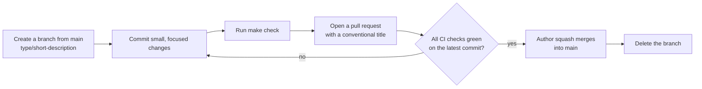

# Contributing

## Workflow

Every change reaches `main` through a pull request. Do not push to `main` directly.



Searchboard is developed by multiple AI agents and human maintainers working in parallel. The pull request is the only way a change reaches `main`, and green CI is the gate for merging it.

1. Branch from `main`. Name the branch `<type>/<short-description>`, for example `feat/esclient-adapter`.
2. Keep each pull request to one logical change. Large features are split into stacked pull requests.
3. Run `make check` locally.
4. Open the pull request using the template. CI must pass.
5. Once every CI check is green on the latest commit, the author merges the pull request with **squash and merge**. The PR title becomes the commit message on `main`.

## Merging

- The author of a pull request merges it. Squash and merge is the only allowed method: no merge commits and no rebase merges.
- AI agents merge their own pull requests as soon as CI is green and do not wait for a human approval. The exact conditions, commands and prohibitions are in [ai-guidelines.md](ai-guidelines.md#merging-your-pull-request).
- If `main` moved, update the branch and wait for CI to pass again before merging.
- Never bypass branch protection and never weaken a check to get a pull request green.
- Delete the branch after merging.

## Pull request title format

Titles follow [Conventional Commits](https://www.conventionalcommits.org/):

```text
<type>(<scope>): <subject>
```

- **type**: `feat`, `fix`, `docs`, `style`, `refactor`, `perf`, `test`, `build`, `ci`, `chore`, `revert`
- **scope** (optional): `server`, `framework`, `api`, `esclient`, `tsdb`, `collector`, `agenthub`, `logengine`, `migration`, `inspector`, `store`, `config`, `domain`, `matrix`, `web`, `agent`, `ci`, `docs`, `deps`, `repo`, `release`
- **subject**: imperative mood, ASCII only, starts with a lowercase letter or digit, no trailing period
- the whole title is at most 72 characters
- append `!` after the scope for breaking changes, for example `feat(api)!: rename cluster routes`

Examples:

```text
feat(esclient): detect cluster flavor and version
fix(matrix): keep relocating shards on their source node
docs: describe the matrix api
```

The `PR title` check runs `scripts/check-pr-title.sh`. That script is the source of truth for allowed types and scopes.

## Language policy

All code, identifiers, comments, log messages, errors, documentation, commit messages and pull request text are written in **English**. CI runs `scripts/check-english.sh` and fails when tracked files contain CJK characters or full-width punctuation.

## Documentation and diagrams

- All documentation lives under `docs/`. The root `README.md` is only an entry point.
- Every architecture, sequence or flow diagram is written in Mermaid. Do not commit diagram images.
- A pull request that changes behavior updates the matching document in `docs/`.

## Review checklist

- The change is small, focused and explained in the PR description.
- Names are descriptive and functions are short enough to read at a glance.
- Errors are handled and wrapped with context. Nothing fails silently.
- Tests cover new behavior and edge cases.
- No secrets, tokens or personal data are committed.
