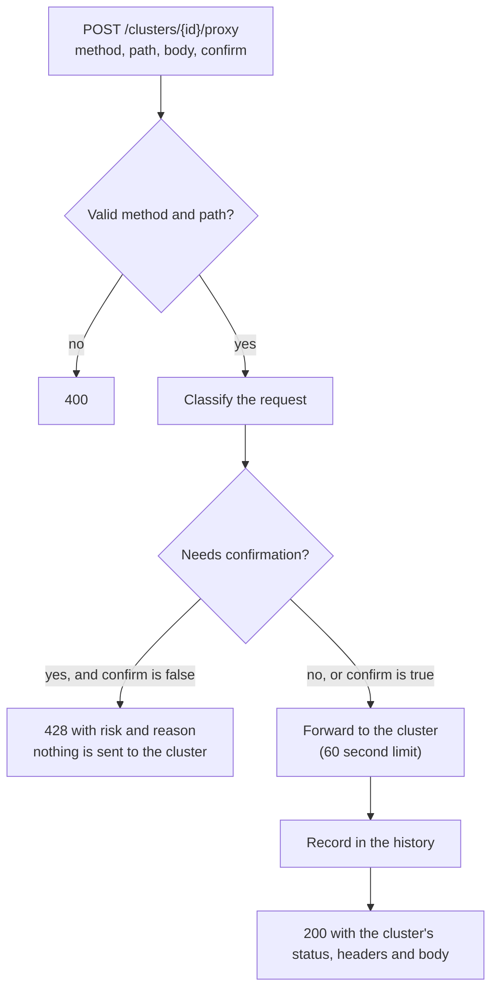

# DevTools Console

The DevTools console lets you send requests to a registered cluster, like the Kibana console, with guard rails for production. This page describes the server side; the editor is described with the web UI.

## How a request is handled



The server decides, not the UI. A client that forgets the check still cannot run a risky request by accident.

## Risk levels

| Level | Meaning | Confirmation |
| :--- | :--- | :--- |
| `safe` | Only reads: every `GET` and `HEAD`, and `POST` to read-only endpoints such as `_search`, `_count`, `_msearch`, `_mget`, `_analyze`, `_validate/query` or `_sql` | Never |
| `write` | Changes documents, mappings or settings | Only on clusters whose environment is `prod` |
| `dangerous` | Can destroy data or disrupt the cluster | Always, on every environment |

Dangerous requests:

- `DELETE` of whole indices: `DELETE logs`, `DELETE logs-*`, `DELETE _all`. Deleting one document is only a write.
- `_delete_by_query`, `_update_by_query`, `_reindex`, `_close`, `_forcemerge`, `_restore`, `_shutdown`, `_cancel`.
- `_cluster/settings`, `_cluster/reroute`, `_cluster/voting_config_exclusions`, node shutdown.
- Any change under `_security`, `_snapshot`, `_data_stream`, index and component templates, `_ilm` and `_slm`.

Anything that is not a plain read and not on those lists counts as a write, so an unknown endpoint errs on the side of caution. The query string is never used for the decision, so `?x=/_search` cannot make a delete look like a search.

When a request is held, the answer is `428 Precondition Required`:

```json
{ "error": "this request needs confirmation", "risk": "dangerous", "reason": "deletes entire indices and everything in them" }
```

Repeat the same request with `"confirm": true` to run it.

## Answers are shown as they are

An error from the cluster, such as a 404 for a missing index or a 400 for a bad query, is the answer the user wants to read. The proxy therefore answers `200` and puts the cluster's status in the body:

```json
{ "status": 404, "content_type": "application/json", "body": "{...}", "duration_ms": 12, "risk": "safe" }
```

Only problems of Searchboard itself use other statuses: `400` for a malformed or unsafe request, `404` for an unknown cluster, `422` when the cluster's answer exceeds 16 MiB, and `502` when the cluster cannot be reached. Details of an unreachable cluster are logged, never returned.

## History

Every request that was executed is recorded per cluster with its status, risk and duration. Requests held for confirmation and failed requests are not.

- The newest 1000 entries per cluster are kept. A request text is cut at 64 KiB.
- Search ignores case and matches text literally, so `%` and `_` are ordinary characters.
- Deleting a cluster deletes its history.
- **History can contain secrets typed into request bodies**, for example a password in a user creation request. It lives in the same owner-only database file as the cluster credentials. Use `DELETE /clusters/{id}/devtools/history` to clear it.

## Schema for completion

`GET /clusters/{id}/schema` returns the indices, aliases and flattened mapping fields (see [esclient.md](esclient.md)). The answer is cached per cluster for 30 seconds, because editors ask often and large clusters are slow, and the cache is dropped when the cluster is deleted.
