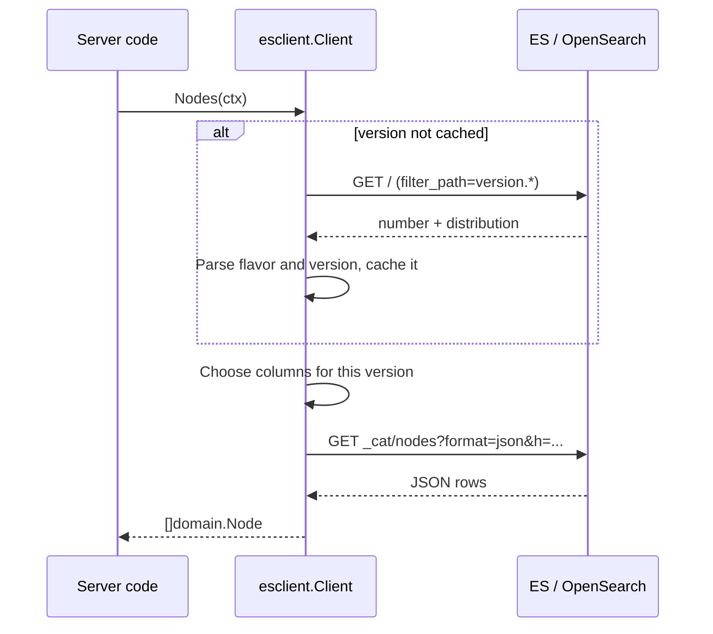

# Elasticsearch and OpenSearch Adapter

The `internal/esclient` package is the only place that knows how Elasticsearch (5.x to 9.x) and OpenSearch (1.x and 2.x) differ. The rest of the server depends on the `ClusterReader` interface and receives version-independent domain types from `internal/domain`.

## Request flow

## Design rules

- **Detect once, adapt per call.** `Client.Version` calls `GET /` on first use and caches the result. Version-dependent behavior is expressed as capability methods on `Version`, never as scattered `if major >= N` checks.
- **Ask for exactly the columns we need.** `_cat` endpoints are called with `format=json` and an explicit `h=` column list. Elasticsearch echoes the requested names as JSON keys, so the parser reads cells by the names it asked for.
- **Tolerate missing data.** Nulls and absent cells become empty values. Metrics that a node did not report are `nil` pointers in the domain model rather than zeros.
- **Fail loudly on malformed data.** An unparsable shard number is an error, not a silently skipped row.
- **Bounded I/O.** Every call has a timeout, and responses are capped at 128 MiB.
- **Typed errors.** A non-2xx response is an `*APIError`. Use `esclient.HasStatus(err, code)` to branch on it.

## Version differences handled

| Concern | Elasticsearch | OpenSearch | Where |
| :--- | :--- | :--- | :--- |
| Flavor detection | `version.number` only | `version.distribution == "opensearch"` | `Client.Version` |
| Elected master column in `_cat/nodes` | `master` | `cluster_manager` (2.x), `master` (1.x) | `Client.Nodes` |
| Point-in-Time search | 7.10 and newer | 2.4 and newer | `Version.SupportsPIT` |
| Reliable `search_after` | 6.8 and newer | all versions | `Version.SupportsSearchAfter` |
| Mapping types removed | 8.0 and newer | 2.0 and newer | `Version.RemovedMappingTypes` |
| Relocating shard rendering | `a -> ip id b` in `node`, `a -> b` in `id` | same | `splitRelocation` |

The migration engine will use the capability methods to pick its reader strategy (see [architecture.md](architecture.md), section 7.2).

## Adding support for a new difference

1. Add a capability method to `Version` with a table-driven test in `version_test.go`.
2. Branch on that method inside the typed API (`Nodes`, `Shards`, ...), not in callers.
3. Add a fake-cluster test that asserts the request the new version receives.
4. Add a row to the table above.
