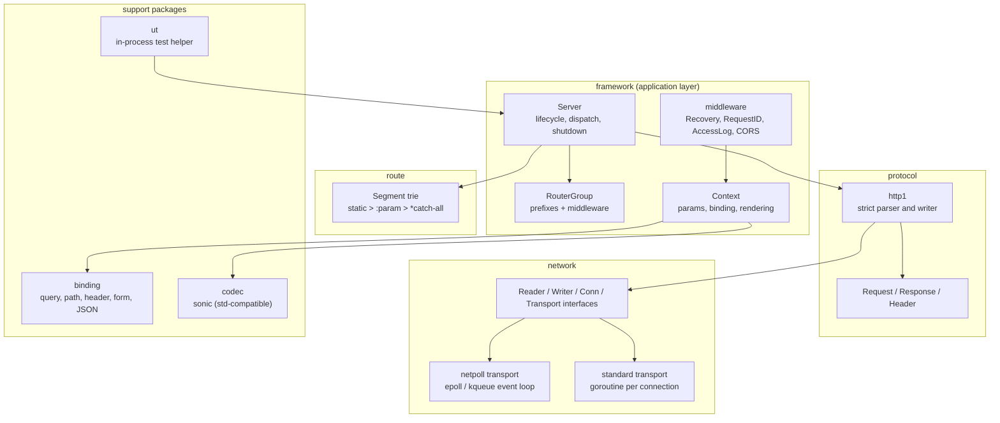
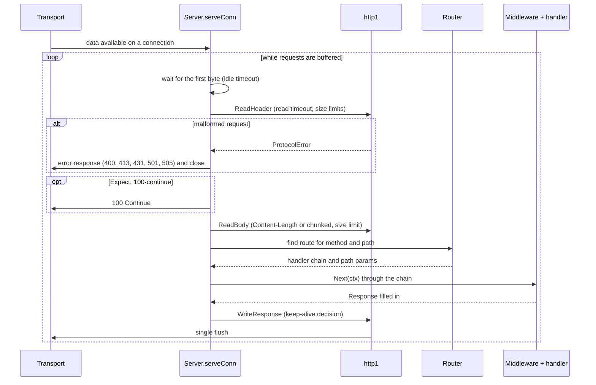
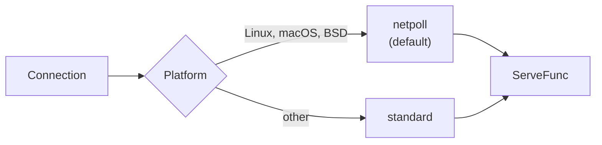
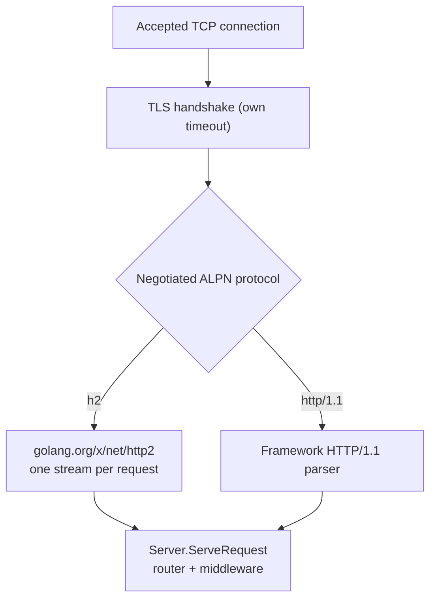
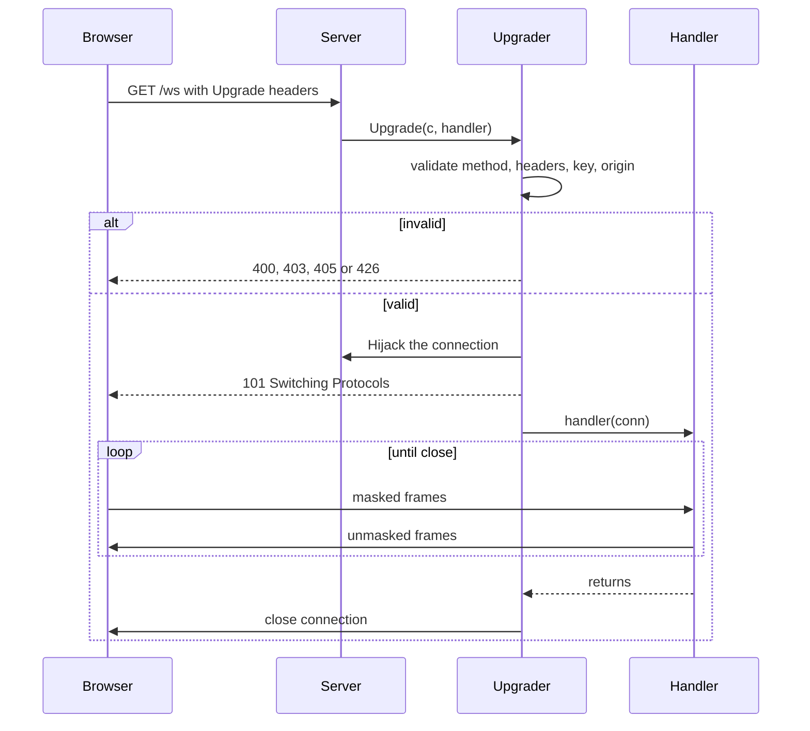
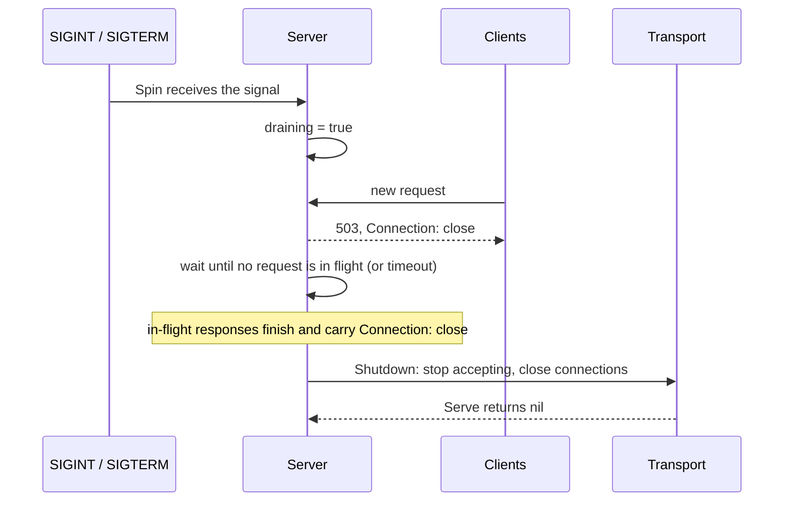
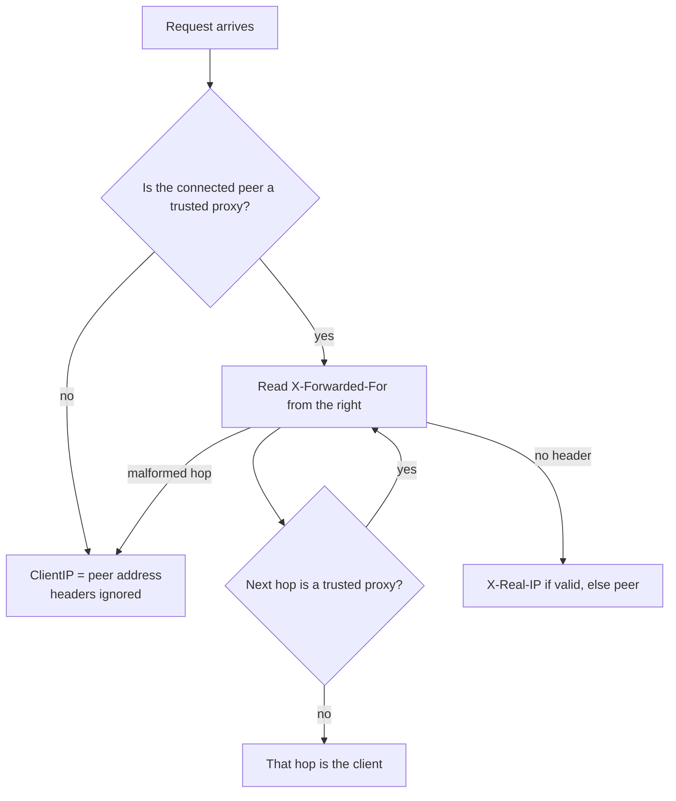

# Web Framework

`framework/` is Searchboard's in-house HTTP/1.1 server framework. It is modeled on [cloudwego/hertz](https://github.com/cloudwego/hertz) and built on the same ideas: a layered stack, a pluggable transport based on [netpoll](https://github.com/cloudwego/netpoll), pooled request contexts and a fast JSON codec ([sonic](https://github.com/bytedance/sonic)). It is deliberately small: only what Searchboard needs, with no code generation and no reflection-heavy magic.

**Status:** the framework is complete and tested but not wired in yet. `internal/api` still uses `chi`; migrating it onto this framework is a separate change.

The framework lives in the same Go module as the server and has no dependency on any other Searchboard package, so it can be moved into its own module later without changes.

## Layers



| Package | Responsibility |
| :--- | :--- |
| `framework` | `Server`, `RouterGroup`, `Context`, options, graceful shutdown |
| `framework/route` | Generic routing tree, independent of the handler type |
| `framework/protocol` | Protocol-independent `Request`, `Response` and `Header` |
| `framework/protocol/http1` | HTTP/1.1 request parser and response writer on top of `network.Reader` / `network.Writer` |
| `framework/network` | Transport interfaces and the two implementations (`netpoll`, `standard`) |
| `framework/binding` | Struct binding and `binding:"required"` validation |
| `framework/codec` | JSON codec (sonic) |
| `framework/middleware` | Ready-made middleware |
| `framework/websocket` | Server side of RFC 6455 on top of a hijacked connection |
| `framework/ut` | Run a request through a server without a network, for tests |

## Quick start

```go
logger := slog.Default()

s := framework.New(framework.WithHostPorts(":8080"))
s.Use(middleware.RequestID(), middleware.AccessLog(logger), middleware.Recovery(logger))

api := s.Group("/api/v1")
api.GET("/users/:id", func(ctx context.Context, c *framework.Context) {
    c.JSON(http.StatusOK, map[string]string{"id": c.Param("id")})
})

if err := s.Spin(); err != nil { // serves until SIGINT or SIGTERM, then drains
    log.Fatal(err)
}
```

Use `middleware.RequestID`, `middleware.AccessLog`, `middleware.Recovery` in that order: the access log then carries the request ID and still observes the 500 that `Recovery` produces.

## Request lifecycle



### Routing rules

- A segment is `static`, `:param` or `*catchall`. At each segment the priority is static, then param, then catch-all, with backtracking: `/users/me` beats `/users/:id`, yet `/users/me/posts` still reaches `/users/:id/posts`.
- A `:param` never matches an empty segment. A catch-all must be the last segment and its value keeps the leading slash (`/files/*path` captures `/a/b.txt`).
- Routing uses the raw, still percent-encoded path. `c.Param` decodes values, so `%2F` never changes which route matches.
- `/a` and `/a/` are different routes. When only the other form exists the server redirects (301 for GET and HEAD, 308 otherwise), and the redirect target can never become a protocol-relative URL.
- `HEAD` falls back to the `GET` route. When the path exists for other methods the server answers `405` with an `Allow` header. Both behaviors are customizable with `NoRoute` and `NoMethod`.
- Registration panics on programmer errors: duplicate routes, conflicting parameter names, a catch-all that is not last.

## HTTP/1.1 strictness

The parser rejects ambiguous framing instead of guessing, which is how request smuggling is prevented:

| Input | Result |
| :--- | :--- |
| Both `Content-Length` and `Transfer-Encoding` | 400 |
| Conflicting or malformed `Content-Length` (sign, non-digits, duplicates that differ) | 400 |
| `Transfer-Encoding` other than exactly `chunked` | 501 |
| Bare LF line endings, obsolete line folding, whitespace before the colon | 400 or connection closed |
| Missing or duplicate `Host` on HTTP/1.1 | 400 |
| Header block larger than `MaxHeaderBytes` (default 32 KiB) or too many fields | 431 |
| Body larger than `MaxBodyBytes` (default 4 MiB) | 413 |
| Unsupported HTTP version | 505 |

Responses never trust handler-supplied `Content-Length`, `Connection` or `Transfer-Encoding`, and CR or LF inside header names or values are replaced by spaces to prevent response splitting.

## Transports



- **netpoll** (default on Linux, macOS and the BSDs) multiplexes connections over epoll or kqueue and reads without copying. netpoll's own idle timeout is only a TCP keepalive period, so the transport arms a per-connection timer to close connections that stay silent for the configured `WithIdleTimeout`.
- **standard** uses one goroutine per connection and a `bufio` reader. Its buffer size (64 KiB by default) caps the largest request header it can read.
- Both implement `network.Transport`. Pass your own with `framework.WithTransport`.

## TLS and HTTP/2

`WithTLS(cfg)` serves HTTPS. TLS needs the standard transport, so the server uses it instead of netpoll unless `WithTransport` says otherwise. The minimum version defaults to TLS 1.2 and the handshake has its own 10 second timeout, so a slow client cannot hold a connection open before sending a request.



- HTTP/2 is on by default with TLS. Turn it off with `WithHTTP2(false)`. Cleartext HTTP/2 (h2c) is not supported.
- Each HTTP/2 stream goes through the same router and middleware as HTTP/1.1. Its `ctx` is canceled when the client resets the stream or the connection drops, which HTTP/1.1 cannot report.
- The body limit (`WithMaxBodyBytes`) and the header limit apply to HTTP/2 as well. Hop-by-hop headers are never sent.
- `c.Scheme()` returns `https` for both protocols.

## WebSocket

`framework/websocket` implements the server side of RFC 6455. It needs to take over the TCP connection, which only the standard transport allows:

```go
s := framework.New(framework.WithTransport(standard.New()))

upgrader := &websocket.Upgrader{ReadLimit: 1 << 20}
s.GET("/ws", func(ctx context.Context, c *framework.Context) {
    _ = upgrader.Upgrade(c, func(conn *websocket.Conn) {
        for {
            kind, data, err := conn.ReadMessage()
            if err != nil {
                return // *websocket.CloseError for a normal or failed close
            }
            _ = conn.WriteMessage(kind, data)
        }
    })
})
```



- The default origin policy only accepts requests without an `Origin` header or with the same host as the request. Allow other origins explicitly with `CheckOrigin`.
- `ReadMessage` answers pings, reassembles fragments, validates UTF-8 for text messages, enforces `ReadLimit` (close code 1009) and rejects protocol violations such as unmasked client frames or reserved bits (close code 1002). A close frame from the peer is echoed and returned as `*CloseError`.
- Writes are safe from several goroutines and are bounded by `WriteTimeout`. `ReadMessage` must be called from one goroutine.
- A hijacked connection stops counting as an in-flight request, so a graceful `Shutdown` does not wait for it. Close WebSockets from a function registered with `Server.RegisterOnShutdown`, for example by sending close code 1001.
- On the default netpoll transport, or over HTTP/2, `Upgrade` answers `501` and returns `framework.ErrHijackUnsupported`.
- Extensions such as permessage-deflate are not supported.

## Graceful shutdown



`Shutdown(ctx)` always closes the transport, even when `ctx` expires first; in that case it returns `ctx.Err()`. `Spin` uses `WithShutdownTimeout` (10 seconds by default).

## Context and handler rules

- Handlers have the signature `func(ctx context.Context, c *framework.Context)`. Middleware calls `c.Next(ctx)`; `c.Abort()` and the `AbortWith...` helpers stop the chain.
- **Contexts, requests, responses and bodies are pooled.** Never keep `c`, `c.Request`, headers or the body after the handler returns. Copy what you need.
- Binding tags: `path`, `query`, `header`, `form` for their sources, `json` for bodies, and `binding:"required"` for validation (a required field must be non-zero; use a pointer to accept a zero value). `c.Bind` merges path, query and the body chosen by `Content-Type`.
- `c.ClientIP()` returns the directly connected peer unless trusted proxies are configured (see [Behind a reverse proxy](#behind-a-reverse-proxy)).
- `ctx` is not canceled when the client disconnects. Use timeouts on downstream calls.

## Cookies

- `c.Cookie(name)` returns the first cookie with that name. It understands several `Cookie` headers, which HTTP/2 clients send, and skips malformed ones.
- `c.SetCookie(cookie)` validates the cookie and adds a `Set-Cookie` header; an invalid name or attribute is returned as an error and nothing is sent. `c.DeleteCookie(name, path, domain)` expires a cookie.
- `framework.SecureSessionCookie` builds a cookie with `HttpOnly`, `Secure`, `SameSite=Lax` and `Path=/`.

## Forms and uploads

- `c.PostForm(key)` reads URL-encoded and multipart form values. `c.FormFile(name)` returns an uploaded file and `c.MultipartForm()` the whole parsed form.
- The body is already in memory and bounded by `WithMaxBodyBytes`, so multipart files stay in memory and no temporary files are written.
- `c.BindForm` and `c.Bind` fill `form` tagged structs from either form encoding.

## Behind a reverse proxy

By default forwarding headers are ignored, because any client can send them. List your proxies with `WithTrustedProxies("10.0.0.0/8", "192.0.2.1")`:



`c.Scheme()` follows the same rule for `X-Forwarded-Proto`. `New` panics when an entry is neither an IP address nor a CIDR range.

## Static files

- `c.FileFS(fsys, name)` serves a file from any `fs.FS`, such as an embedded directory. The name is cleaned and anchored at the root, so `..` can never escape it. It sets `Content-Type`, `ETag` (and `Last-Modified` when the file system has a time) and answers `304` to a matching `If-None-Match`.
- `group.StaticFS("/assets", fsys, StaticOptions{...})` serves a directory tree for `GET` and `HEAD`. `StaticOptions` sets the directory index file and a per-file `Cache-Control`.
- `FileHandler(fsys, opts)` serves the request path and is meant for `NoRoute`, which is how a single-page application is served after the API routes had their chance.

## Dependencies

| Library | Used for |
| :--- | :--- |
| `github.com/cloudwego/netpoll` | Event-loop transport |
| `github.com/bytedance/sonic` | JSON codec in standard-library compatible mode |
| `github.com/bytedance/gopkg` (`lang/mcache`) | Pooled buffers for request bodies |
| `golang.org/x/net/http2` | HTTP/2 over TLS |

sonic below v1.15.5 does not support Go 1.27: it falls back to `encoding/json` and prints a warning at start-up. Keep sonic at v1.15.5 or newer. The codec is isolated in `framework/codec`, so swapping it is a one-file change.

## Not supported

Cleartext HTTP/2 (h2c), WebSocket over HTTP/2, WebSocket extensions (permessage-deflate), streaming responses such as Server-Sent Events (responses are buffered and written once), and range requests for static files. They can be added behind the existing layers when needed.

## Testing

- `ut.PerformRequest(server, method, target, body, headers...)` runs a request through routing and middleware with no network.
- `framework/e2e_test.go` and the feature tests exercise real TCP connections against both transports: keep-alive, pipelining, chunked bodies, `Expect: 100-continue`, malformed requests, timeouts and graceful shutdown.
- Parser and writer tests feed the stream one byte at a time to prove they handle partial reads.
